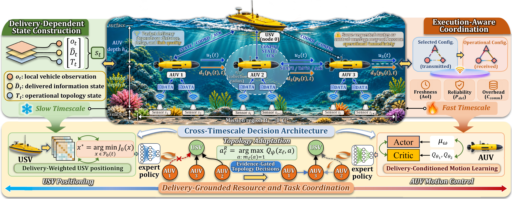
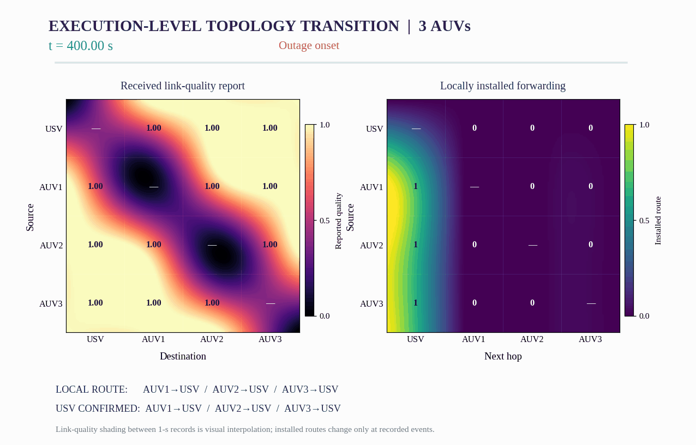
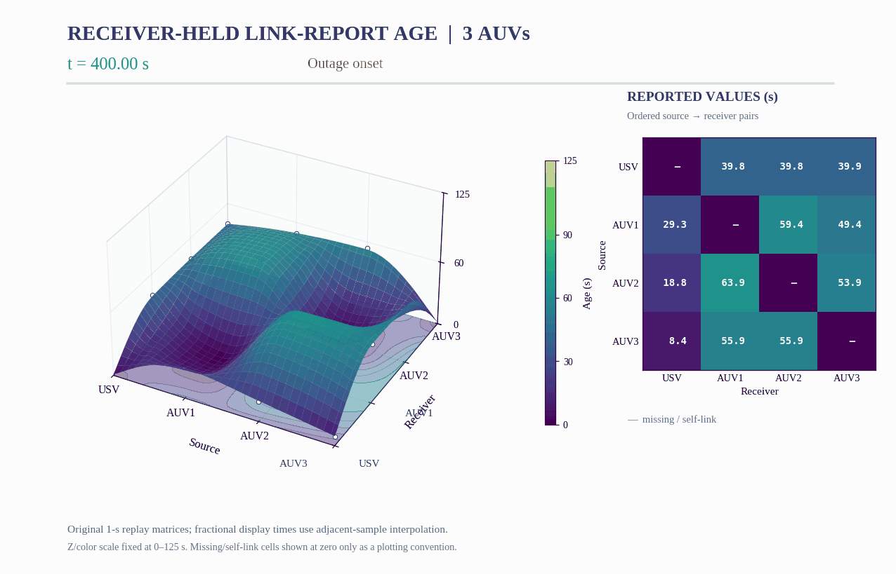
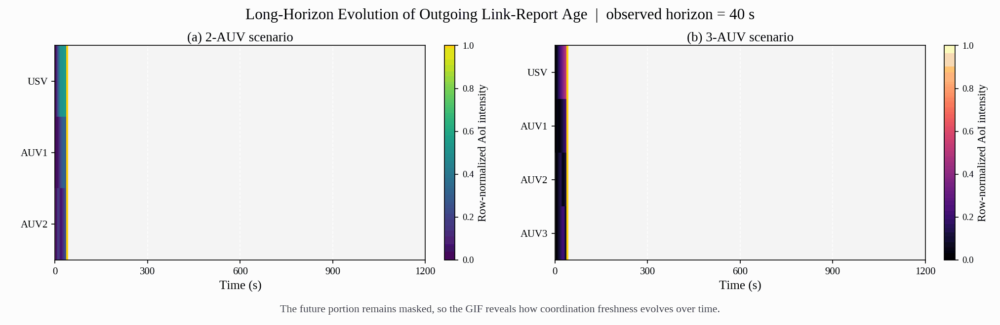
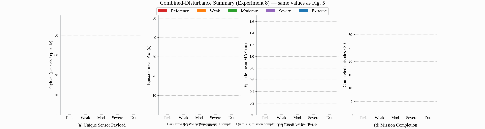
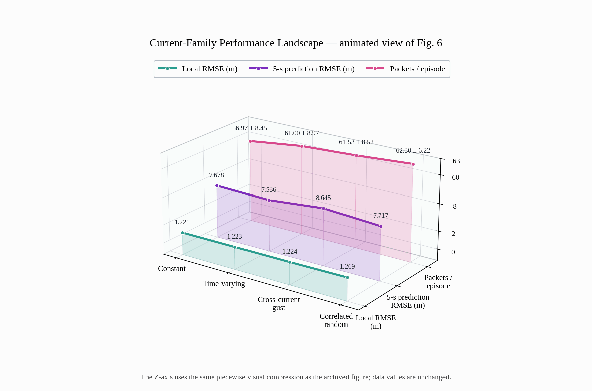

# Visual Guide for Reviewers

This guide presents the original figure style and archived data from `Code.zip` using **one high-resolution static overview (Fig. 1)** and **five reviewer-friendly GIF animations (Figs. 2–6)**. Notably, `Code.zip` provides the source code and data used in the paper. The goal for the visualization here is to make the core mechanisms of the paper easier to follow at a glance: how delivery-aware coordination becomes operational, how topology and freshness evolve over time, and how the proposed framework behaves under stress.

All visuals are derived from the figure assets, plotting scripts, or archived data bundled in the supplied ZIP. The Fig. 1 PNG is rendered directly from its source PDF at 360 dpi without changing the artwork; the remaining GIFs retain their previous data and visual style.

---

## 1. Framework overview

This **high-resolution static overview (4,129 × 1,608 pixels)** presents the full framework in one view: **delivery-dependent state construction**, the **underwater USV–AUV execution scene**, **execution-aware coordination**, and the **cross-timescale decision architecture**. Keeping this complex system figure static makes its annotations and relationships easier to inspect, while the subsequent animations show individual experimental processes and outcomes.



---

## 2. Execution-level topology transition in the 3AUV case

The next GIF uses the complete per-second 3AUV replay, with the six representative Fig. 2 snapshots as timing anchors (111 fixed-canvas frames). It shows how a disruption triggers a relay request, how local relay installation appears before global confirmation, and how the system eventually restores direct routing. The link-quality color fields update smoothly for display, but the installed and confirmed route matrices change discretely according to the archived execution records. In this way, the animation more clearly highlights one of the key messages of the paper: **a requested configuration is not automatically the same as an operational configuration**.



*Visualization note.* Smooth shading between native 1-s samples is only a presentation effect. The parent-vector values remain the recorded locally installed and root-confirmed configurations, rather than interpolated or hypothetical routes.

---

## 3. Receiver-held link-report age surfaces

To complement the topology transition, the following GIF replays the complete 1-s report-age series, with the original Fig. 3 event timestamps as anchors, rendered as 108 frames on a fixed 3D canvas. A synchronized numeric matrix shows the values of each directed source–receiver pair. The fixed camera and fixed Z/color range remove frame-to-frame layout drift. Between adjacent 1-s samples, displayed values are interpolated for visual continuity; sudden report-age resets caused by actual packet arrivals remain meaningful events, not rendering errors. This lets reviewers observe how information freshness evolves asynchronously across ordered node pairs. This provides a more process-level demonstration that **freshness renewal and route installation are related but distinct events**.



*Visualization note.* The diagonal and missing observations are displayed as zero-height points in the 3D surface, matching the original Fig. 3 convention; the accompanying value matrix marks them as unavailable. No interpolated frame should be interpreted as an additional simulator observation.

---

## 4. Long-horizon AoI evolution in the 2AUV and 3AUV scenarios

Whereas the previous two GIFs focus on representative events, this animation reveals the longer temporal story. The heatmaps progressively expose the row-normalized outgoing link-report age in the 2AUV and 3AUV cases from 0 to 1200 s. As the observation horizon expands, reviewers can visually track how different robots experience different freshness patterns, which supports the paper’s emphasis on **asynchronous, delivery-grounded coordination rather than synchronized global knowledge**.



---

## 5. Combined-disturbance summary metrics

The following GIF converts Fig. 5 into an animated summary. The bars grow into the archived means, while the whiskers reveal the reported sample standard deviations. Presented this way, the five disturbance regimes—Reference, Weak, Moderate, Severe, and Extreme—become easier to compare across the four dimensions that matter most for the reviewer: **payload**, **state freshness**, **local navigation error**, and **mission completion**. This offers a concise visual summary of robustness under progressively stronger disturbances.



---

## 6. Current-family performance landscape

Finally, the last GIF turns Fig. 6 into a gently rotating 3D view. This preserves the original waterfall style while making the metric relationships more legible from multiple viewing angles. In particular, it helps reviewers see how the performance profile changes across **constant**, **time-varying**, **cross-current gust**, and **correlated random** current families, while simultaneously comparing **local RMSE**, **5-s prediction RMSE**, and **packets per episode**.



---

## Concluding remark

Taken together, the high-resolution overview and five GIFs aim to make the contribution of the paper more immediately visible to reviewers. Instead of reading each static figure independently, reviewers can follow the work as a connected story: first the framework, then the event-level execution dynamics, next the evolution of freshness over time, and finally the aggregated robustness results. This visual presentation is especially useful for emphasizing the central innovation of the paper—namely, that **what matters is not only which coordination decision is planned, but which information, configuration, and transmission opportunity actually become operational after real delivery events**.

## File structure

- `assets/01_framework_overview.png` (static, 4,129 × 1,608 pixels)
- `assets/02_topology_transition_3auv.gif`
- `assets/03_link_age_3d.gif`
- `assets/04_aoi_evolution.gif`
- `assets/05_joint_disturbance_metrics.gif`
- `assets/06_current_family_waterfall.gif`


## Regenerating the fixed-canvas animations

To reproduce animations 02 and 03 using the included archived matrix series:

```bash
pip install numpy scipy matplotlib pillow
python tools/rebuild_smooth_02_03.py
```

The local data copy is located at `source_data/TMC_2AUV_3AUV_Three_Matrices_Real_Data.zip`. The GIF renderers use a fixed pixel canvas, camera, axis range, and global palette to eliminate horizontal jitter. Their intermediate frames interpolate adjacent original 1-second measurements for visual continuity; *topology state is never interpolated*.
